# What Two Integer Matrices Determine, and What Only a Proof Can Say

## Exact methods for Alpöge's complex structure on the six-sphere

### A Python implementation of the finite layer of the construction, with every number reached twice where it can be, thirty-four facts machine-checked, and a ledger of what is quoted

---

## Summary

In August 2026 Levent Alpöge posted a construction answering the question Heinz
Hopf raised in the late 1940s (published 1948): does the six-sphere carry a
complex structure? The answer
it gives is yes. It builds a compact complex threefold `X`, fibred over `P¹` by
complex 2-tori with singular fibres over three points, and proves `X`
diffeomorphic to `S⁶`. The construction also contradicts a published corollary
of Campana, Demailly and Peternell, and the paper's last section locates the
step at which the two accounts part. Philip Engel wrote a pedagogical account
within days; Boris Alexeev formalised the headline statement in Lean 4 over
Mathlib. As of this writing the community's view, as reported, is that the
construction is plausible, and the result is not yet refereed.

Almost all of the proof is analysis and topology — holomorphic period
functions on the upper half plane, a toric filling after Mumford, two
logarithmic transforms after Kodaira, van Kampen and Mayer–Vietoris over torus
bundles, Smale's h-cobordism theorem, and `Θ₆ = 0`. None of that is done here.
But the construction stands on two 4×4 integer matrices,

    T₁ = [[1, 0, −6, 2], [0, −1, 1, 1], [0, −1, 0, 1], [0, 0, 0, 1]]   (order 3)
    T₂ = [[1, 6, 0, −3], [0, 0, −1, 1], [0, 1, 0, 0], [0, 0, 0, 1]]    (order 4)

whose product is unipotent — a representation of the (3, 4, ∞) triangle group —
and a surprising share of what the paper proves is decided by linear algebra
over `Z`, by rational identities in three symbols, by lattice combinatorics, or
by arithmetic in a Picard group. `pyCICY.sixsphere` implements that layer, and
`pyCICY.sixsphere_lean` proves its finite part in Lean. Five things are worth
stating on their own:

1. **Every number in the finite layer reproduces**, and most of them by two or
   three routes that share no code: the fundamental group's order three ways,
   `e(W) = 2` three ways, the transformation laws of the periods three ways,
   the fibre types of the elliptic surface behind `τ` two ways.
2. **Two rules the paper states are derived here instead.** The freeness of
   the logarithmic transforms (`3 ∤ ℓ₁`, `ℓ₂` odd) comes out of a fixed-point
   computation on the real torus; the fibre types IV\*, III, I₁ come out of the
   lattice with Noether's formula, without the Weierstrass model.
3. **A test the paper does not run.** Friedman's triple-point formula must
   hold on every double curve of the cusp fibre, because it is a reduced
   normal-crossings fibre in a smooth total space. It does — and on the `P²`
   fan the same sum is 4, so the check can fail.
4. **Why the classical canonical-bundle formula fails on `X`, as arithmetic.**
   In the subgroup of `Pic(X)` generated by the fibre class and the two
   multiple-fibre reductions, `K_X = −6u`, and the classical formula would give
   `5u`; the difference is not a pull-back.
5. **Thirty-four facts machine-checked**, Mathlib-free, several universally
   quantified — among them that *every* cone of the infinite cusp fan is
   unimodular — and the controls that guard the checker found a real hole in
   it.
6. **The paper's data is forced.** Among the lattice data of its shape, only
   the (3, 4, ∞) triangle group can give a homology sphere, and within it the
   paper's matrices are, up to conjugacy, the only data that reaches
   `|p| = 1` in every box searched.
7. **The cusp fibre is the monotile's substrate, rolled up — and the mystic
   tile lands on six fibres.** The cusp fibre `W` is the [3.4.6.4] Laves
   lattice, the Hat's substrate at its own proportions, rolled up on a torus.
   No Hat tiling descends to that torus. Folding a computed Hat tiling onto it
   anyway, the "mystic" tile (the Turtle, ten kites) lands on exactly six
   points in patches of three and four substitution steps: one per orientation,
   each anchored on the midpoint of a double curve of `W`, two orientations per
   curve. Six is the number of oriented edges of the dual complex of `W`, a
   one-vertex, three-edge, two-triangle torus. At most 72 classes is proved;
   exactly six is a conjecture backed by finite patches.
8. **An integer inflation behaves the other way on the same kind of torus.**
   Tsiokos's Chair44, the three-dimensional einstein tile, inflates by the integer
   2, so its supertiles sit on the nested sublattices `2^M Z³` of index `8^M` and the
   tiling is exhausted by the tori `R³ / 2^M Z³`. Where no Hat tiling descends to the
   cusp torus, a Chair44 patch of 1.8 million cells agrees with its own translate by
   `2^M` along an axis on 68.4%, 91.0% and 97.6% of cells for `M = 3, 4, 5`, and the
   disagreement is bounded by an exact, proved rate `c(M)/8^M` with
   `c(M) = 28·2^M − 48`. Part VIII computes this, shows it, and says what it does
   not connect: the six-sphere contains no Chair44, and two tempting matches
   (24 simplices round a vertex against 24 rotations; the (3, 4, ∞) group against the
   cube group) are settled as coincidences.

What is *not* here is the theorem. That `X` is diffeomorphic to `S⁶` is
declined, and nothing in this package bears on whether the proof is correct
beyond its finite layer. The ledger below says, for every quantity, which of
five things it is: exact, exact by two or more routes, machine-checked,
quoted, or declined.

---

## Where it lives

The mathematics is `pyCICY/sixsphere.py`; the Lean layer is
`pyCICY/sixsphere_lean.py`. The construction is also registered as
`theories.ComplexSixSphere`, key `complex-six-sphere`, with `X = None`, so that
the question a string theorist asks first — *can you compactify on it?* — has
an answer in the same place as every other construction's.

The answer is a ledger entry of the third kind. `K_X` is not torsion, so `X`
carries no nowhere-vanishing holomorphic 3-form, and `b₂ = 0` rules out a
Kähler metric. Every four-dimensional `N = 1` vacuum this package describes on
a complex threefold needs that form — Calabi–Yau, and the non-Kähler heterotic
backgrounds of the Strominger system alike. So `spectrum`,
`holomorphic_yukawa`, `physical_yukawa` and `fermion_masses` all raise
`NoSuchTheory`, including `physical_yukawa`, whose base class would otherwise
raise `NeedsMetric` and blame the metric for an absence that has nothing to do
with it.

One contrast worth keeping visible. String theory already uses `S⁶`, as the
nearly-Kähler coset `G₂/SU(3)`, whose almost complex structure is the
octonionic one and is *not* integrable. The new structure is integrable and
unrelated: it is not produced from a metric, and LeBrun's theorem forbids it
from being orthogonal for the round one. Nothing about the old
compactifications transfers.

The work was done in parts, each a code, a test and a documentation commit:
five that implement the construction's exact layer, this write-up, and a
seventh that asks which other data could have been used, and an eighth (Part VIII,
`pyCICY.chair44_nested`) that asks what an integer-inflation tile does on the same kind of torus. `status()`, `status_periods()`,
`status_cusp()` and `status_invariants()` run the 17, 17, 18 and 30 checks of
the first four parts; `sixsphere_lean.status()` runs the fifth.

---

## Part I: the lattice layer

Everything starts from `T₁`, `T₂` and their contragredients
`A_j = (T_j⁻¹)ᵗ` on the dual lattice `Λ = V*`.

| quantity | value | how |
| --- | --- | --- |
| `det T₁`, `det T₂` | 1, 1 | computed |
| orders of `T₁`, `T₂` | 3, 4 | computed |
| `T₀ = (T₁T₂)⁻¹ = I + N` | `N ≠ 0`, `N² = 0`, `ker N = im N` | computed |
| `A₁A₂M₀` | `I` | computed |
| `Λ^{A₁}`, `Λ^{A₂}` | `⟨ε, δ̂⟩`, `⟨ε′, δ̂⟩` | saturated integer kernels, against the paper's generators |
| coinvariants `V_G`, `Λ_G` | `Z`, `Z` | Smith form of `[(T₁−I) \| (T₂−I)]`: `diag(1,1,1,0)` |
| invariant alternating forms | `Z·Q₀`, `Q₀(u,w) = 6` | solved for |
| invariant bivectors | `Z·η`, `η = u∧w + 6γ∧δ`, `η² = 12 vol` | solved for, separately |
| `b = Q₀(·, N·)` on `V/ker N` | `diag(6, −1)` | computed |
| `B₀` | `[[0, 1], [−1, 0]]`, `det = 1` | read off `M₀ − I` |
| smallest invariant subgroup ⊇ `Λ_tor` | `ker γ` | closed by iterating the monodromy |

The two solves for the invariant form and the invariant bivector share no
code, and agree: `η = ⋆Q₀`. So neither the 6 in `Q₀` nor the 12 in `η²` is
taken on trust. And `b` being indefinite is the whole reason the family carries
no polarisation, and why the very general fibre is not algebraic.

### Freeness, derived

The paper states that the logarithmic transform at `p_j` is free exactly when
`3 ∤ ℓ₁`, resp. `ℓ₂` is odd. Here that is not quoted. The `k`-th power of the
transform moves `x ↦ Aᵏx + c_k` on the real torus, with
`c_k = (I + A + ⋯ + A^{k−1}) v / m`, and it has a fixed point iff `c_k` lies in
the real image of `Aᵏ − I` plus `Λ`. Taking a saturated integer basis `P` of the
annihilator of that image, the test is whether `P c_k` is integral. The rule
comes out on 52 twist vectors at each point, and it says something the bare
rule does not: an even `ℓ₂` is caught at `k = 2`, and at no other power.

### The order of the fundamental group

`|p| = |12ℓ₀ − 4ℓ₁ − 3ℓ₂|` is the output of the paper's van Kampen
computation. In Part I it was set against the order of `H₁` of the Seifert
fibred space over `S²(3, 4)`, computed from its presentation by Smith form; all
729 triples in a box agree, and `(0, 1, −1)` gives the three-sphere. That
confirms the paper's footnote — the formula is Orlik's in disguise — and no
more. Part IV adds the route that does bear on `X`.

---

## Part II: the period laws

The family of 2-tori is written through three holomorphic functions `τ, μ, β`
on the upper half plane, with period matrix `Π = [Z | I]`,
`Z = [[6μ, τ], [β, μ]]`. Their existence is a lifting argument and two torsor
problems on `P¹`, and is declined. Every law they obey is a rational identity,
and those are checked three ways.

**As printed.** `g₁³` and `g₂⁴` act trivially on `(τ, μ, β)`, and `g₁g₂` acts
by `(τ+1, μ, β−1)`, which gives the cusp law. Closure of the `β`-law *is* the
vanishing of the paper's cocycle sums (Proposition 3.13); both are computed.

**Forced by the integers.** `Π(gz) = R_g Π(z) M_g` with `M_g = Tᵗ`, and
`Π(gz)` must again have right block `I`. That determines the law of each
generator from its 4×4 matrix alone. It reproduces the printed laws and the
printed `R_g`, and it passes a consistency condition the matrices did not have
to satisfy — the new `Z` must keep the shape `[[6μ′, τ′], [β′, μ′]]`. That
condition is not a formality: it fails for 47 of 53 single-entry perturbations
of `T₁` and `T₂`, including changing the `−6` in `T₁` to `−5`.

**On the elliptic curve.** Modulo `γ`, `σ₁ = τu + w`, so the subquotient
`⟨u, w⟩` of `V` carries an elliptic curve's `H₁`, and its three 2×2 matrices
reproduce the `τ`-laws a third time.

The real layer is checked as identities in real symbols: `det_ℝ Π = Im τ · D`,
`D` invariant under both generators, and the Hodge form on `F¹` equal to
`−[[12 Im τ, 12 Im μ], [12 Im μ, 2 Im β]]` with determinant `24 Im τ · D`. Since
`D < 0` is imposed, the signature is `(1, 1)` for every choice of the free
constant: the analytic face of `b = diag(6, −1)`.

### The elliptic surface behind τ, by two routes

`τ` is the period map of the rational elliptic surface
`y² = 4x³ − 3t³(t−1)x − t⁴(t−1)²`, `j = 1728t`, with fibres IV\*, III, I₁. But
`j` fixes an elliptic surface only up to quadratic twist, and a twist changes
fibre types: twisting by `(t−1)` keeps `j = 1728t` and turns the III into III\*.
So agreement on `j` alone would prove little.

- **Weierstrass.** The vanishing orders of `f, g, Δ` at `0, 1, ∞` go through
  `theories.ftheory.kodaira_type` — code written for F-theory with no knowledge
  of this construction — and come back IV\*, III, I₁.
- **Lattice.** The subquotient's `SL₂(Z)` classes — order 3 and trace −1,
  order 4 and trace 0, unipotent with `n = 1` — narrow the fibres to
  {IV, IV\*}, {III, III\*} and I₁. Order and trace cannot see an orientation
  convention, which is why a star ambiguity survives. Noether's formula
  resolves it: the Euler numbers of an elliptic surface sum to `12χ(O)`, and
  of the four sums 8, 12, 14, 18 exactly one is a multiple of 12.

The lattice route never sees the Weierstrass model; the Weierstrass route
never sees `T₁, T₂`. They agree. The Kodaira table the lattice route uses is
quoted, and is itself checked against `ftheory`.

The paper runs a version of the lattice argument too, in Proposition 9.11 —
which Part II had not yet read when it was written. The two differ usefully.
The paper allows I₁ or I₁\* at the cusp (`j` has a simple pole either way) and
needs `e = 12` exactly, from its own `deg K = 1`; that exactness matters,
because 7 + 8 + 9 = 24 is also a multiple of 12. The subquotient here carries
the honest sign at the cusp, trace `+2`, which excludes I₁\*, so it needs only
`12 | e` and does not use `deg K` — which Part IV then recovers.

---

## Part III: the cusp fibre

At the cusp the family is filled in by a quotient of an infinite smooth toric
threefold whose fan is the cone over the A₂ triangulation of the plane.
Freeness and properness of the quotient are estimates, and are declined.
Everything else is lattice combinatorics.

| quantity | value | routes |
| --- | --- | --- |
| cone determinants | +1 lower, −1 upper | computed on a patch; *proved* for all `(x, y)` in Part V |
| `t` in every chart | `z₀z₁z₂` | dual bases sum to `(0,0,1)` |
| volume form | `±dz₀dz₁dz₂`, so `K` of the filling is trivial | dual bases unimodular |
| `π₁` of the toric model | 1 | Smith form of the ray matrix |
| the component `E₀` | `dP6`, six (−1)-curves, degree 6 | `pyCICY.toric` (which calls it `B3`); and from the fan, with Noether `K² + e = 12` |
| components, double curves, triple points | 1, 3, 2 | orbits of cells under `B₀Z²` |
| gluing | opposite hexagon sides, nothing else; corners alternate between the two triple points | orbits of cells |
| `e(W)` | 2 | torus-orbit strata; the normalisation, `6 − 6 + 2`; Betti numbers (Part IV) |

The six rays around a vertex come out in the same cyclic order as the paper's
and as `hexagonRay` in the Lean formalisation, and a test pins that.

**Friedman's triple-point formula.** `W` is a reduced normal-crossings fibre
in a smooth total space (Theorem 4.5 (d)), so every double curve `C` with
branches on components `V, V′` must satisfy
`(C|_V)² + (C|_V′)² + T_C = 0`, `T_C` the number of triple points on `C`. The
formula is used nowhere in the construction, so it tests the gluing rather
than restating it. It holds: every double curve is a (−1)-side on both
branches and carries two triple points.

**Remark 4.9, computed.** With `B₀` a parameter, `|det B₀| = d` gives `d`
components, `3d` double curves, `2d` triple points and `e(W) = 2d` by both
routes, for `d = 1…5`; the dual complex is a triangulated torus every time and
the triple-point formula holds throughout. `W` depends only on the lattice
`B₀Z²`: any unimodular `B₀` gives the same fibre. Unimodularity is exactly what
makes the cusp contribute the 2 that `S⁶` needs.

---

## Part IV: topology and invariants

Sections 7 and 9 of the paper compute the topology by van Kampen and
Mayer–Vietoris over torus bundles, and the complex-analytic invariants by
analysis on the fibres. More of both than expected reduces to arithmetic.

**`|p|` a third way.** Theorem 7.17 gives `π₁(X)` by generators and relations
before simplifying: the fibre `Λ`, two meridian lifts `x, y`, the monodromy
conjugations, `Λ_tor = 1`, `x³ = t_{v₁}`, `y⁴ = t_{v₂}`, `xy = t_μ`.
Abelianised directly on all six generators and Smith-reduced — without the
paper's own reduction to three generators — it gives `Z/|p|`. That agrees with
the closed form and the Seifert `H₁` over 160 admissible twists and values of
`ℓ₀`, with `gcd(p, 12) = 1` throughout. Flipping the sign at one of the two
multiple fibres turns order 1 into 7, which is what the paper's sign lemma
exists to exclude. That the group is abelian is the paper's argument and stays
quoted.

**The cusp from the monodromy alone.** The Betti numbers of `W` are the ranks
of the `T₀`-invariants of `∧^q V`, `(1, 2, 4, 2, 1)`, with the invariant
lattices exactly as printed in Proposition 7.12 and the kernels of
specialisation saturated of the complementary rank. The boundary of the cusp
neighbourhood is a torus bundle over a circle; the Wang sequence gives its
ranks `(1, 3, 6, 6, 3, 1)` from the same invariants.

**The multiple fibres.** At each `p_j` the image of `A_j − I` is
`ker γ ∩ ker ψ_j`, the coinvariants are `Z²`, and `H₁(S_j)` is torsion-free
exactly for admissible twists. The indices of Proposition 7.14 come out of
Gram determinants: `(3, 1, 1)` at `p₁` and `(4, 2, 2)` at `p₂`, from `det = −9,
−4` in degree 2 and `3, 2` for the pairing of degrees 1 and 3. Unimodularity
of `H²(S_j)` is quoted.

**Riemann–Roch from Chern roots.** Hirzebruch–Riemann–Roch in dimension
three, computed from Chern roots and symmetrised. The general output reproduces
the textbook `χ(T) = c₁³/2 − 19c₁c₂/24 + c₃/2` and gives 15 on `P³`. On `X`,
with `c₁ = c₂ = 0` and `c₃ = 2`:

    χ(O, Ω¹, Ω², Ω³, T) = (0, −1, 1, 0, 1).

`χ(O) = 0` also comes out of the Leray sequence of the paper's direct images.

**The Hodge numbers.** Serre duality, `h^{p,0} = (1,0,0,0)`, the Leray
`h^{0,q} = (1,1,0,0)` and the Riemann–Roch values leave exactly one free
integer:

    h¹¹ = h²² = h¹² + 1,   h¹² open.

No Hodge symmetry is assumed — `h¹⁰ = 0` while `h⁰¹ = 1` — and the Frölicher
spectral sequence cannot degenerate at `E₁`, whatever `h¹²` is. The paper
leaves `h¹²` open too, and expects 1.

**Why the classical canonical-bundle formula fails.** The subgroup of `Pic(X)`
generated by `H = f*O(1)` and the two multiple-fibre reductions, with
`3S₁ = 4S₂ = H`, is infinite cyclic: `S₁ = 4u`, `S₂ = 3u`, `H = 12u`. It embeds
in `Pic(X) ≅ C` because `u ≠ 0`. There:

| class | value |
| --- | --- |
| `K_X = −H + 2S₂` (Theorem 9.1) | `−6u`: not torsion |
| the classical `−H + 2S₁ + 3S₂` | `5u` |
| their difference `2S₁ + S₂` | `11u`, not in `12Z·u`: not a pull-back |
| normal forms `kH + aS₁ + bS₂`, `0 ≤ a < 3`, `0 ≤ b < 4` | only `(−1, 0, 2)` |

That is the paper's footnote to Section 10 — where [CDP20]'s printed proof
applies the classical formula — turned into arithmetic. Coprimality of 3 and 4
is what keeps the group torsion-free; with multiplicities (3, 3) it would not
be.

**The Hodge bundle, twice.** `deg f_*ω_{X/B} = 1` from the Kodaira Euler
numbers of Part II, `(8 + 3 + 1)/12`, and from the local exponents
`2/3 + 1/4 + 1/12`, whose numerators come from the vanishing orders of `E₄` at
`ρ` and `E₆` at `i` and the ramification of `τ`. Twelve times the exponents
are the fibre Euler numbers `8, 3, 1`.

**The C\* action.** The vertical vector field is the cocharacter `δ̂ ↔ e₂` of
the toric model. In the cusp model it fixes no vertex stratum and exactly one
edge stratum — the double curve of direction `e₂`, through both triple points —
and acts on the chart coordinates at a triple point with weights `(−1, 0, +1)`:
tangent weight 0, normal weights `(+1, −1)`, and
`e(fixed locus) = e(P¹) = 2 = e(X)`. The cocharacter `e₁` fixes a different
curve, so the check does see which field it is given. That nothing outside the
cusp is fixed is quoted.

---

## Part V: machine-checked

`pyCICY.sixsphere_lean` follows `nariai_lean`: every fact is a Lean 4 theorem
paired with the Python callable that computes the same claim; every matrix in
the Lean file is generated from the object `sixsphere` computes with; and the
`#print axioms` report is parsed, never assumed.

Thirty facts, Mathlib-free, proved by `decide`, `omega` and `grind`, and
kernel-checked by Lean 4.33.0 in about three seconds; Part VII adds four more
— two gcd obstructions, the conjugator onto the paper's data, and the
achirality of the lattice — for thirty-four. The concrete ones cover
Part I's lattice layer, the twists and `|p|`, the Kodaira subquotient and
Noether's selection, the hexagon of `E₀`, the `C*` weights, the Picard
coordinates, and each power of each logarithmic transform. The universally
quantified ones are where Lean adds most:

| fact | statement |
| --- | --- |
| `invariant_forms_unique` | every integer solution of `TᵗQT = Q` is a multiple of `Q₀` |
| `invariant_bivectors_unique` | every integer solution of `TETᵗ = E` is a multiple of `η` |
| `p_coprime_12` | `gcd(p, 12) = 1` for all admissible `ℓ₁, ℓ₂` and all `ℓ₀` |
| `seifert_det`, `pi1_relation_det` | the relation determinants, as identities in the twists |
| `fan_unimodular` | every cone of the infinite A₂ fan is unimodular, for all `(x, y)` |
| `K_normal_form_unique` | `K_X`'s normal form in `Pic` is unique |

The linear systems in the two uniqueness theorems are generated from the
matrices by sympy, and the Python half checks they are exactly the entries of
`TᵗQT − Q` and `TETᵗ − E`. What Lean does not see is stated per fact: Smith
normal forms (the step from a determinant to a group order), saturation of
lattices, the symbolic period laws, Riemann–Roch, and all of the analysis.

**The axiom policy is an allow-list.** A fact counts as machine-checked only if
every axiom in its report is one of Lean's three standard axioms, `propext`,
`Quot.sound` and `Classical.choice` — the set the HopfProblem Comparator
permits. 29 of the 34 facts are also choice-free; the five that are not are the
quantified `omega` and `grind` proofs, and they are listed.

The policy became an allow-list because a deny-list failed a control. The
checker inherited from `nariai_lean` refused `sorryAx` and `Classical.choice`
by name. Lean 4.33 compiles `native_decide` not to `Lean.ofReduceBool` but to a
fresh auxiliary axiom per proof, `<thm>._native.native_decide.ax_N`, and a list
of forbidden names cannot anticipate that — nor a plain user-declared `axiom`.
The shared core, `nariai_lean.check_source`, now takes an allow-list:
`propext` and `Quot.sound` for Nariai, which preserves its no-choice claim, and
the three standard axioms here. Five controls run against the kernel on every
test run with a toolchain — a false fact, a `sorry`, a `native_decide`, a
declared axiom, and `T₁` with `−5` for `−6` — and all five are refused. Without
a toolchain the file is still emitted, the Python half still runs, and nothing
is claimed as checked.

---

## Part VII: which data can build it, and what it touches

`pyCICY.sixsphere_search` turns the construction around and asks whether it
could have run on other data. The search is restricted to the *flag class*:
pairs `(T₁, T₂)` in `SL(4, Z)` of the block shape Lemma 2.7 (iii) proves the
paper's matrices have,

    T = [[1, r, s], [0, M, c], [0, 0, 1]],   M ∈ SL(2, Z),

with `M` the Kodaira monodromy of Part II. Data outside that shape is not
searched.

### Only (3, 4, ∞)

| step | eliminates | status |
| --- | --- | --- |
| finite orders in `SL₂(Z)` are 1, 2, 3, 4, 6 | all other orders | enumerated |
| the only involution is `−I`, central, so the cusp cannot be unipotent | (2,3), (2,4), (2,6) | proved |
| no unipotent product; for (3,3), (6,6) only `−(unipotent)`, an I₂\* cusp | (3,3), (4,4), (6,6) | observed, stable in boxes ±4 and ±7 |
| `p = m₁m₂ℓ₀ − m₂ℓ₁ − m₁ℓ₂ ≡ 0 mod gcd(m₁, m₂)` | (3,6), (4,6) | proved; machine-checked |

`(3, 6)` and `(4, 6)` carry consistent elliptic surfaces — IV\* + II + I₂ and
III\* + II + I₁ both sum to 12 — but their best `|p|` is 3 and 2. The paper's
triangle group is not a choice.

### Within it, the paper's matrices

Conjugation by `[[1, x, z], [0, I, y], [0, 0, 1]]` acts by
`r ↦ r + x(M − I)`, `c ↦ c + (I − M)y`, with the same `x, y` for both
generators; derived symbolically. `M₂ − I` has determinant 2, so `T₂`'s data
reduces to 2 × 2 residue classes and nothing is left to normalise `T₁`: the
extensions form infinite families. A funnel searches them in a stated box and
reports every stage:

| stage | box ±5 |
| --- | --- |
| candidates tried | 87 846 |
| `T₁³ = T₂⁴ = I` (the corner integral) | 49 446 |
| unipotent cusp, `N² = 0`, `rank N = 2` | 272 |
| coinvariants exactly `Z` | 84 |
| invariant closure of `Λ_tor` is `ker γ` | 84 |
| `\|det B₀\| = 1` | 32 |

The 32 survivors fall into four `GL(4, Z)` conjugacy classes of eight. They
are distinguished by an invariant — the set of `|p|` reachable by admissible
twists, mod 12 — so their distinctness is a proof, not a failed search; the
memberships are explicit conjugators, each verified. The invariants are
`{1, 5}`, `{3}`, `{2, 4}` and `{0, 6}`. Exactly one class reaches `|p| = 1`,
and the explicit

    P = [[1, 3, −3, −2], [0, 1, 0, 0], [0, 0, 1, −1], [0, 0, 0, −1]],   det P = −1,

carries the paper's `(T₁, T₂)` onto its representative — a fact the Lean
kernel checks. The other three bottom out at `|p|` = 3, 2 and 6.

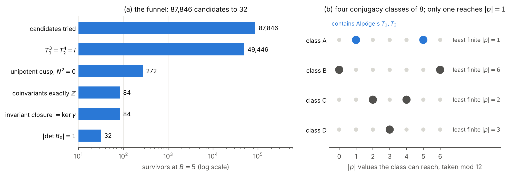

*Left: the funnel above, on a log scale. Right: the four classes; their
reachable `|p|` sets partition {0, …, 6}, and only the class containing
Alpöge's matrices reaches 1.*

Two observations, reported as such. The final count is 32 at every box from
±3 to ±11, while the cusp stage grows 136, 200, 272, 760, 1488: evidence that
the `|det B₀| = 1` condition cuts the infinite family to a finite set, not a
proof. And the closure stage has never removed a candidate, which suggests it
follows from the coinvariant condition in this class; unproved. Whether the
three near-miss classes support period functions — and so a complex manifold
at all — is not a lattice question and is declined.

### The cusp fibre is the monotile's substrate, rolled up

![The Hat as eight kites of the [3.4.6.4] Laves lattice at a:b = √3:1](paper/figures/ss_hat_kites.png)

*The Hat at `a : b = √3 : 1`: its thirteen-sided outline is exactly eight
whole kites of the lattice (their areas add to `8√3`; checked in
`paper/make_sixsphere_figures.py` before the figure is drawn).*

The Hat is a union of eight kites of the
[3.4.6.4] Laves lattice, which `pyCICY.monotile` builds exactly in `Q(√3)`.
(The Turtle is ten kites of the same lattice; the Spectre is not a union of its
kites at all — see "Hat, Spectre, Turtle" below.)
At the regular proportions `a = √3·b`, all 61 sites of its patch are cells of
the A₂ triangulation of Part III, of the matching kind, and its 102 bonds are
exactly the 102 cover relations between them. The Laves lattice is the Hasse
diagram of the cusp fan, and `W` is that lattice rolled up on `R²/B₀Z²`:

| Laves kite lattice | cusp fibre `W` | per domain |
| --- | --- | --- |
| hexagon centre (valence 6) | a `dP6` component | 1 |
| edge midpoint (valence 4) | a double curve | 3 |
| hexagon vertex (valence 3) | a triple point | 2 |
| kite | a corner of the `dP6` hexagon | 6 |
| centre–edge bond | a (−1)-curve of the hexagon | 6 |
| edge–vertex bond | a double curve through a triple point | 6 |

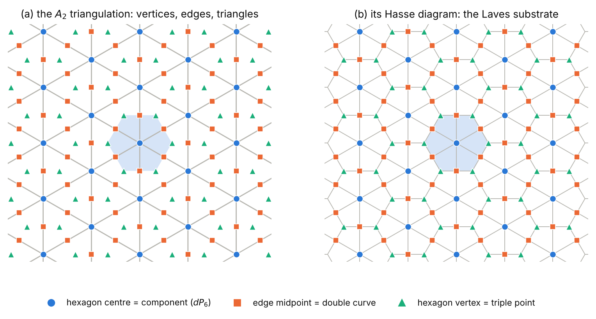

*Circles are vertices / hexagon centres, squares are edges / edge midpoints,
triangles are triangles / hexagon vertices. The figure script asserts that the
sites and bonds of the two panels agree before drawing.*

So `e(W) = 2` counts the hexagon vertices in a fundamental domain,
`V − E + F = 6 − 12 + 6 = 0` is the torus, and Friedman's formula reads: each
edge midpoint touches two hexagon vertices. The relation to the monotile is a
contrast rather than an identity of tilings — the substrate descends to the
torus, and no Hat tiling can, because an aperiodic tiling is invariant under
no lattice. Both inherit the lattice from A₂; the six-sphere knows nothing of
monotiles. At the Spectre's proportions `a = b` the combinatorics survive but
the metric match does not, and the test suite checks that too.

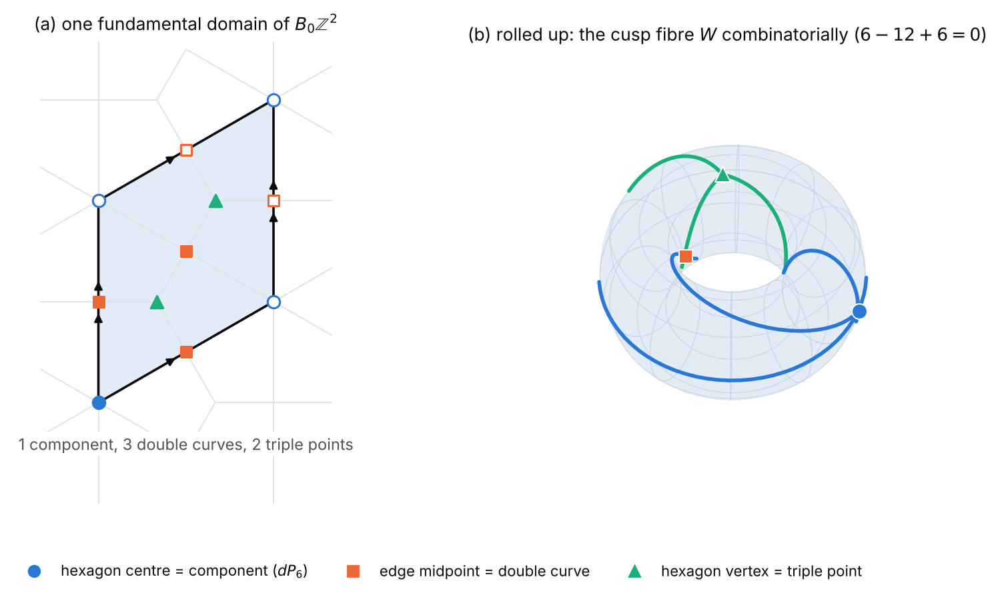

*One fundamental domain holds 1 component, 3 double curves and 2 triple
points, with 6 + 6 bonds; rolled up, `6 − 12 + 6 = 0`. The far side of the
torus is hidden.*

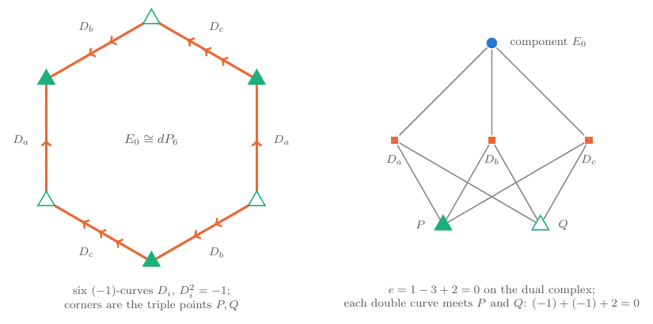

*The component `dP6` and its incidence structure, drawn from
`sixsphere.cusp_fibre()`: opposite sides are glued (equal arrow counts) into the
three double curves, and the six corners fall on two triple points, `P` and `Q`,
alternating. Every double curve passes through both, which is Friedman's
`−1 − 1 + 2 = 0`.*

### The dual complex of the cusp fibre

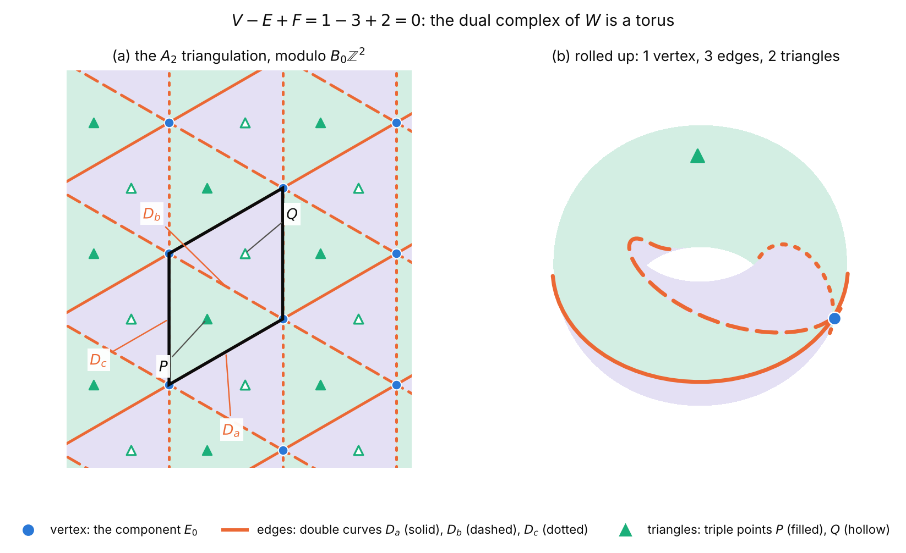

*The dual complex of `W` has one vertex (the `dP6` component), three edges (the
double curves `D_a`, `D_b`, `D_c`, along `e₁`, `e₂ − e₁`, `e₂`) and two triangles
(the triple points `P`, `Q`): `1 − 3 + 2 = 0`, a torus. Every edge borders both
triangles. Counts and incidences are asserted against
`sixsphere.cusp_fibre()` by `paper/make_sixsphere_dual_complex.py` before the
figure is drawn.* It has `2E = 6` oriented edges, a number that returns below.

### Rolling up a Hat tiling

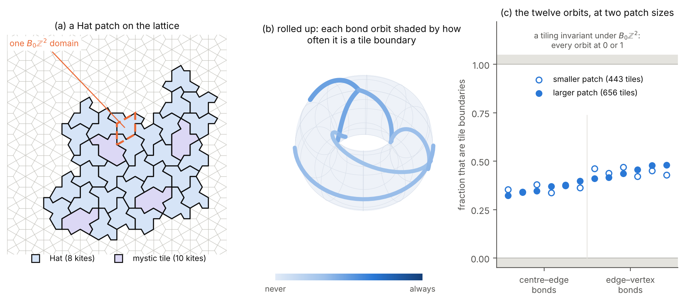

*A substitution patch of the Hat (generated by `spectre.py` from
[brentharts/spectre](https://github.com/brentharts/spectre), imported by
`paper/make_sixsphere_hat_torus.py`), 443 tiles at three steps and 656 at four.
Every vertex is asserted to lie on a Laves site, every Hat to be eight whole
kites and every mystic ten.*

A lattice bond is a *tile boundary* if its two adjacent kites belong to
different tiles. A tiling invariant under `B₀Z²` would make each of the twelve
bond orbits of the torus a boundary always or never. For the patch, the
fractions are 0.323 to 0.480: none is 0 or 1. That is a finite-patch
certificate that the tiling does not descend, not a proof of aperiodicity.

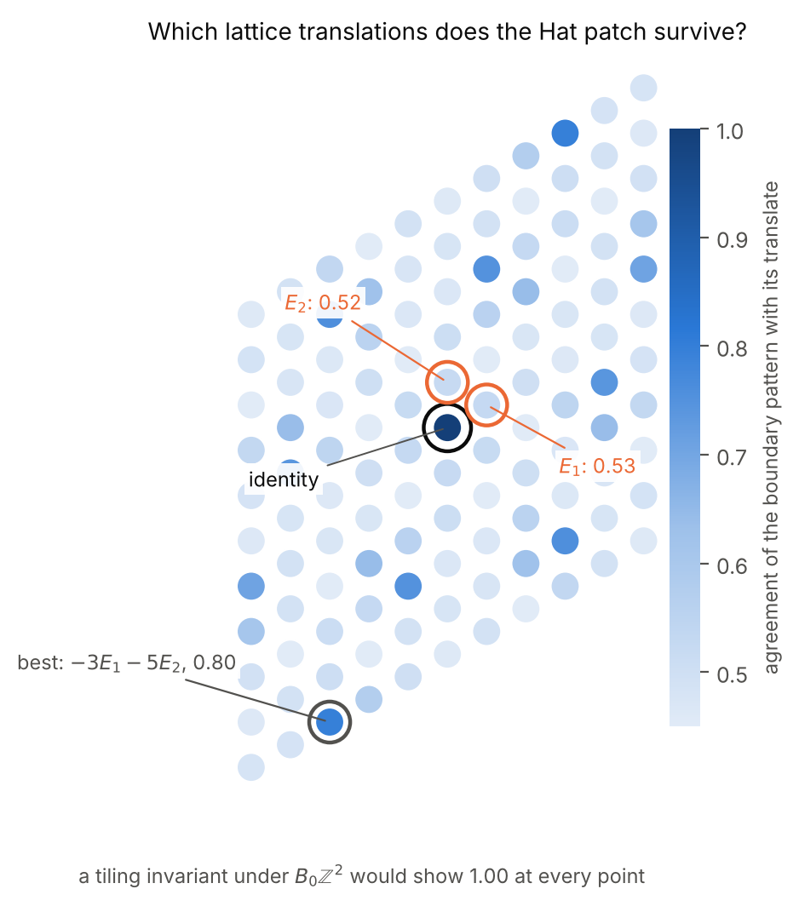

*Agreement with each lattice translate `iE₁ + jE₂`. The best non-identity
agreement at four steps is 0.796, at `(−3, −5)`; none reaches 1.*

### Hat, Spectre, Turtle

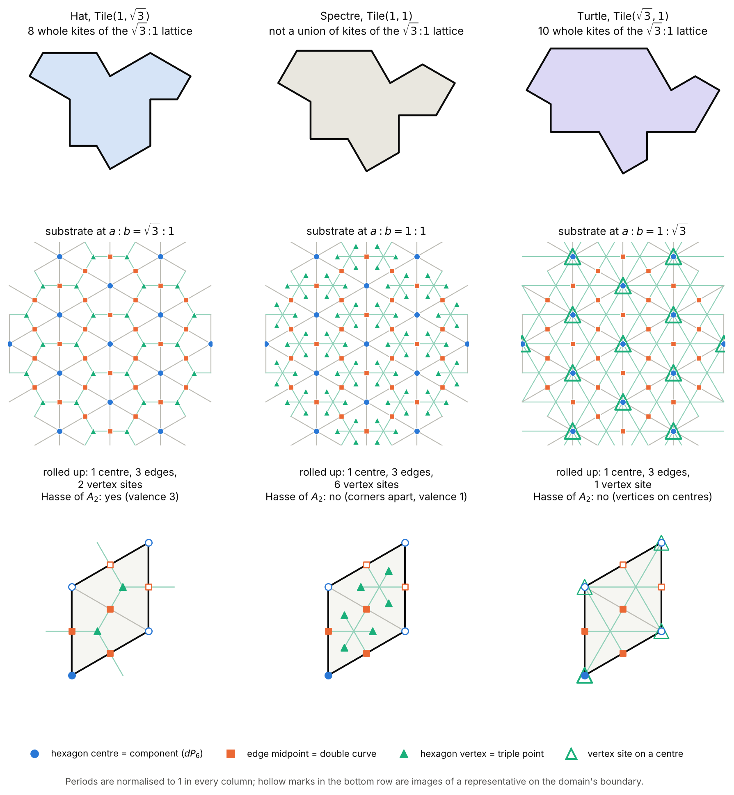

| Tile | substrate `a : b` | sites per domain (centre, edge, vertex) | Hasse diagram of A₂ | kites of the √3 : 1 lattice |
| --- | --- | --- | --- | --- |
| Hat `Tile(1, √3)` | √3 : 1 | 1, 3, 2 | yes | 8 |
| Spectre `Tile(1, 1)` | 1 : 1 | 1, 3, 6 (vertex valence 1) | no | not a union |
| Turtle `Tile(√3, 1)` | 1 : √3 | 1, 3, 1 (vertex sites on centres) | no | 10 |

Only the Hat's substrate is the cusp fan's Hasse diagram. The Turtle's own
substrate is degenerate — its vertex sites coincide with neighbouring centres —
but as a *tile* it is ten whole kites of the Hat's lattice, which is why it can
be folded onto the same torus. The Spectre cannot.

### Mystic fibres

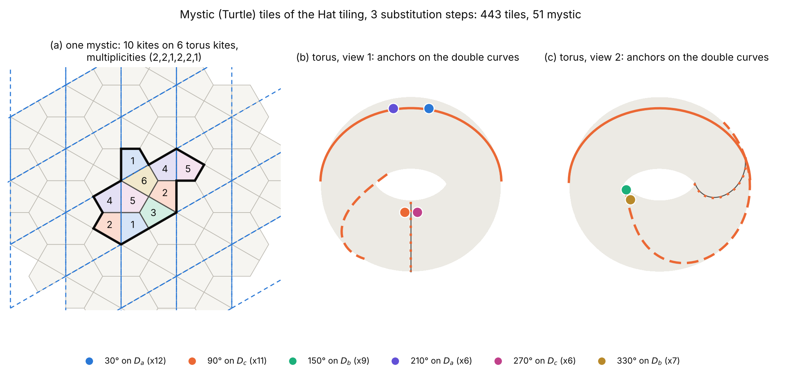

Two mystics are in the same *fibre class* if they differ by an element of
`B₀Z²`. Computed on the substitution patches (`paper/make_sixsphere_mystic_fibres.py`):

| steps | tiles | mystics | fibre classes | class sizes |
| --- | --- | --- | --- | --- |
| 1 | 9 | 1 | 1 | 1 |
| 2 | 71 | 8 | 5 | 1, 1, 2, 2, 2 |
| 3 | 443 | 51 | 6 | 6, 6, 7, 9, 11, 12 |
| 4 | 656 (a disc) | 76 | 6 | 6, 7, 12, 14, 17, 20 |

- **Proved:** at most `12 · 6 = 72` classes (12 first-edge angles, 6 site
  classes for the anchor vertex), and a translation preserving the kite tiling
  lies in `B₀Z²` (six kites meet only at centres).
- **Observed (n = 3, 4):** the mystics occur in exactly six first-edge angles
  (30°, 90°, …, 330°); the anchor vertex is always an edge-midpoint site, fixed
  by the angle: `D_a` for 30° and 210°, `D_c` for 90° and 270°, `D_b` for 150°
  and 330°. So the six classes are the six *oriented* double curves — the `2E`
  of the dual complex.
- **Conjecture:** for every `n ≥ 3`, exactly these six. No proof; it would have
  to come from the metatile structure of the substitution.
- **An indication, from small samples:** in some classes the members have
  different neighbours (two environments in three classes at `n = 3` and `n = 4`,
  among one to nine interior mystics each). A tiling that descended would have
  identical surroundings throughout a class, so this is the tile-level form of
  the boundary-fraction certificate.

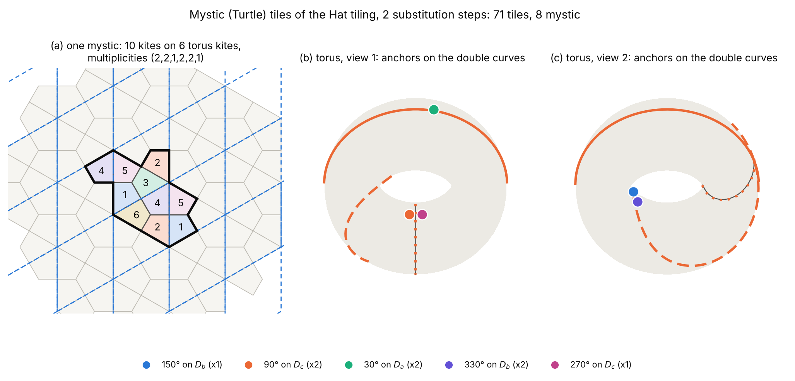

*At two steps the classes of size two are an accident of the small patch; the
information is in the angle and anchor above.*

### Chirality, duality, arithmetic

- **Achiral.** Reversing the base orientation replaces `(T₁, T₂)` by
  `(T₁⁻¹, T₂⁻¹)`, and an explicit `P` of determinant 1 conjugates one pair to
  the other — machine-checked. The monodromy cannot tell `X` from its
  orientation-reversed counterpart; that is not a proof that they are
  biholomorphic. The record is in `pyCICY.chirality`'s format, as a new
  domain beside knots, polygons and Calabi–Yaus.
- **Not self-dual.** `Q₀` makes `V` and its dual isomorphic over `Q`, but
  every integral intertwiner has determinant `36s⁴`, never ±1. A sharper form
  of "no polarisation": not even a non-positive principal one.
- **Fields.** The elliptic values generate `Q(√−3, i) = Q(ζ₁₂)`, square
  classes `{±1, ±3}`: `Q(√3)` is shared with the monotiles' geometry, and
  nothing with the Hat's `Q(√5)` or the Spectre's `Q(√6, √10)`.
- **Hyperbolic, necessarily.** The only Euclidean triangle groups are
  (2,3,6), (2,4,4), (3,3,3); none contains both 3 and 4. The monotile's
  substrate symmetry is Euclidean; the six-sphere's base cannot be.
- **Hofstadter.** The cusp component's polygon is `toric`'s B3, whose
  hoppings are the triangular lattice's: its mirror curve is the
  triangular-lattice Hofstadter model of `pyCICY.quantum_curve`.

Two resemblances are coincidences, and settled as such. The class 6 is shared
by `b`'s isotropic slopes `±√6` and the Spectre's inflation
`λ = (√6 + √10)/2` — but the six-sphere's 6 is `Q₀(u, w)`, from the `−6` in
`T₁`, and the Spectre's comes from `λ² = 4 + √15`; nothing uses either. And
the Laves valences (6, 4, 3) echo the orbifold orders (3, 4, ∞), but the
valence-4 sites are double curves over the cusp, not over the order-4 point.

One bug surfaced on the way. `ninelink._squarefree` dropped signs — harmless
for the real fields it had been used on, but it would have reported
`Q(√−3, i)` as `Q(√3)`, and with it a false identity between the six-sphere's
period field and the monotiles'. It now keeps them.

---

## Part VIII: an integer inflation on the same kind of torus

Part VII ends with a negative: no Hat tiling descends to the cusp torus, and a
Hat patch agrees with no lattice translate of itself beyond 0.796. That is what an
aperiodic tiling with an irrational inflation does. Tsiokos's Chair44 — the
three-dimensional "einstein" tile of arXiv 2609.19214 and 2609.23783
(`ioannist/six-birds-tiles`, CC BY 4.0) — is the other kind of aperiodic object. It
is a seven-cube chair, `2 × 2 × 2` minus a corner, decorated so that it tiles only
aperiodically, and its substitution has **eight children and inflation factor 2, an
integer**. Everything here is computed by `pyCICY.chair44_nested`, which carries its
own copy of the substitution (the eight child poses, re-checked to tile every rotated
doubled chair) and depends on nothing outside the package. The six-sphere does not
contain Chair44; what follows is a comparison of two kinds of tiling on tori, and the
ledger says for each statement what kind it is.

### Why nested tori

An integer inflation is a lattice map. A level-`M` supertile is a Chair44 scaled by
`2^M`, so the level-`M` supertiles are placed on `2^M Z³`, a sublattice of index
`8^M`; a level-`M` block contains `8^M` unit cells, one parent cell's worth. The
natural family of tori is therefore `R³ / 2^M Z³`, each one a cover of the last. The
Hat's and the Spectre's inflations are irrational (the fields in the previous section),
so they leave no such family.

This echoes, as a count and nothing more, Remark 4.9: `|det B₀| = d` gives `d`
components, `3d` double curves, `2d` triple points and `e(W) = 2d`, so an index-`d`
sublattice of the cusp lattice is `d` copies of the fundamental domain. In the plane the
nested sublattices have index `4^M`; for Chair44 they have index `8^M`. The cusp
fibre of Part III is two-dimensional; no complex fourfold with a Chair44 cusp fibre is
built here, and none is claimed.

### How nearly Chair44 descends

The substitution acts on `168 = 24 × 7` labelled unit cells (24 rotations, 7 cells), sends
each label to the eight labels of its `2 × 2 × 2` block, has every column sum equal to 8
and is primitive at power 3. Reading `M` digits of a position inside a level-`M` block
and tracking the set of labels still possible gives a subset automaton with 209 reachable
sets, 41 of them with more than one label. Let `c(M)` count the addresses of the `2^M`
cube at which the label is *not yet* the same for every starting label, and `E(M)` the
total number of surplus candidate labels, `Σ(|set| − 1)`:

| `M` | 0 | 1 | 2 | 3 | 4 | 5 | 6 | 7 | 8 |
| --- | --- | --- | --- | --- | --- | --- | --- | --- | --- |
| addresses `8^M` | 1 | 8 | 64 | 512 | 4096 | 32768 | 262144 | 2097152 | 16777216 |
| `c(M)` | 1 | 8 | 64 | 176 | 400 | 848 | 1744 | 3536 | 7120 |
| `E(M)` | 167 | 328 | 608 | 1168 | 2288 | 4528 | 9008 | 17968 | 35888 |

The least coincidence depth is 3, with 336 of 512 addresses coincident, as upstream
records (`THEOREM.md`, the modular coincidence). The closed forms are

    c(M) = 28·2^M − 48,     E(M) = 140·2^M + 48,          for every M ≥ 1.

They are *proved*, not fitted: both sequences are read off the 41-state transfer matrix, so
the difference from a closed form with roots 2 and 1 is a linear recurrence of order at
most 43, and it vanishes if it vanishes on 43 consecutive terms; 44 are checked. (The
closed form for `c` holds from `M = 1`, a little earlier than the `M ≥ 3` first stated in
the Spectre paper; it fails at `M = 0`.) The fraction of undetermined addresses,
`c(M)/8^M ≈ 28·4^{−M}`, tends to 0.

The consequence is an inequality with no experiment in it. If two cells lie `2^M v`
apart, they sit at the same address of two level-`M` blocks, whatever the labels of the
two parent cells. They must agree wherever the address is coincident. So on any patch that
is a union of whole level-`M` blocks, **the agreement with the translate by `2^M v` is at
least `1 − c(M)/8^M`.** The table measures what the actual patch does. The patch is the
chair scaled by `2^6`, 1 835 008 cells, and the bound holds on all fifteen rows
(three axes, `M = 1…5`):

| translate along `x` | agreement | proved bound |
| --- | --- | --- |
| `2` | 0.000 | 0 |
| `4` | 0.073 | 0 |
| `8` | 0.684 | 0.656 |
| `16` | 0.910 | 0.902 |
| `32` | 0.976 | 0.974 |

Translation by 2 agrees on *no* cell, and every odd translate tested agrees on none either;
the disagreement then falls by about a factor of four per step, the same `4^{−M}` that
the bound has.

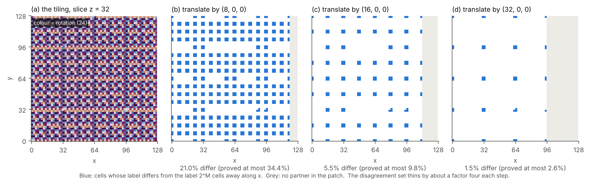

*One `z`-slice of the level-6 patch. (a) the label field, coloured by rotation only.
(b–d) cells whose label differs from the label `2^M` cells away along `x`, in blue: 21.0%,
5.5% and 1.5% of the slice, against proved ceilings of 34.4%, 9.8% and 2.6%. The
disagreement is a thin, regular set that thins by about four at each step; the grey strip
is where the translate leaves the patch.*

### Where the near-periods are

The same agreement can be computed for *every* translate at once (the autocorrelation of
the 168 label indicators, by FFT, in integers, with the rounding error checked below
`10⁻³`). On a level-5 patch of 229 376 cells, restricting to translates that overlap the
patch in at least an eighth of its cells:

| agreement at least | translates | by 2-adic valuation of the vector |
| --- | --- | --- |
| 0.5 | 2550 | 2: 1254, 3: 1120, 4: 152, 5: 24 |
| 0.9 | 342 | 3: 166, 4: 152, 5: 24 |
| 0.99 | 6 | 5: 6 |

Every near-period is divisible by a power of 2, none has valuation 0 or 1, and the six at
99% are the corner translates `(±32, ±32, ±32)`, as large as the patch allows. This is
one patch and an observation, not a theorem about all patches; the inequality above is
what is proved.

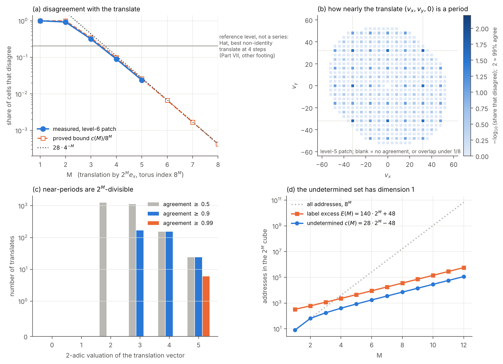

*(a) Measured disagreement (blue) against the proved bound `c(M)/8^M` (orange) and its
asymptote `28·4^{−M}`. The grey level is the Hat's best non-identity disagreement from
Part VII, 1 − 0.796, drawn as a reference level and not as a series: it was measured on
translates of a four-step Laves patch, not on this footing. Chair44's disagreement is
below it from `M = 4`. (b) How nearly each in-plane translate is a period; the strongest
are multiples of 16 and 32. (c) The valuations of the near-periods. (d) The undetermined
addresses grow like `2^M`, the volume like `8^M`.*

### What is left undetermined

The undetermined set is small in the right sense. `c(M)` grows like `2^M` in a cube of
`8^M` addresses, and the transfer matrix on the 41 non-singleton states has characteristic
polynomial `x⁵(x − 2)⁴(x − 1)³²`, spectral radius exactly 2. In the 2-adic internal space
`Z₂³` the set where the label is not yet fixed has box dimension `log₂ 2 = 1`.

What remains at such an address is also structured. At `M = 12`, of `8^12 ≈ 6.9·10¹⁰`
addresses 114 640 are undetermined; **114 624 of them carry exactly six candidate labels
(six rotations), and the other 16 carry 24 labels, all 24 rotations.** The six rotations are
in every case a coset of an order-6 subgroup of the cube's rotation group: one identity,
three half-turns, two third-turns, all fixing a body diagonal as an axis. The substitution
therefore fixes the orientation of such a cell up to the dihedral group of a body
diagonal, which contains the symmetry the undecorated chair has about its own diagonal
(the cyclic group of order 3; its other symmetries are mirrors). The count of 6 is not
related here to the six mystic fibre classes of Part VII, where six is the number of
oriented double curves of the dual complex; no mechanism is known and I treat it as a
coincidence until one appears.

### Two things that are not connections

*The three-dimensional cusp analogue.* The A₂ triangulation behind the cusp fan is
Kuhn's triangulation of `Z²`; its three-dimensional version is Kuhn's triangulation of
`Z³`. Per fundamental domain it has 1, 7, 12 and 6 simplices (`χ = 0`; the plane has 1, 3,
2), and 24 `= 4!` simplices round a vertex, whose dual polytope is the truncated
octahedron, the analogue of the `dP6` hexagon. The count 24 is also the order of the cube's
rotation group, which is the orientation group of Chair44, and one would like that to be
a symmetry. It is not. Of the cube group's 48 elements, 12 preserve the complex (6 of the 24
rotations); the complex has a linear automorphism group of its own, also of order 48,
meeting the cube group in those 12 elements; and the two are not conjugate in `GL(3, Z)`,
because reduced mod 2 the cube group fixes a nonzero vector of `F₂³` and the other group
fixes none. The same mismatch is already visible in the plane, where the cusp torus is
hexagonal and the square lattice is not. So 24 = 24 is numerology, and Chair44 does not sit
equivariantly on this complex.

*The orbifold group.* The cube's rotation group is a quotient of the base orbifold group
`Z/3 * Z/4` of Alpöge's construction, with the cusp loop sent to a half-turn (the
`(2, 3, 4)` triangle group). The corresponding `S₄` cover of the orbifold is
smooth of genus 0 with 12 cusps (Riemann–Hurwitz). That is exact group theory, and
nothing connects it to the six-sphere's monodromy representation; nothing computed here
shows that representation factors through this quotient.

### What this says, and does not

The contrast is of kind. The Hat's substrate descends to the cusp torus and the Hat does
not; Chair44's inflation is a lattice map, so it has a whole tower of tori to nearly descend
to, with a defect that is exactly `c(M)/8^M ~ 28·4^{−M}`. That is the finite shadow of what
the cited theory (Lee–Moody, Schlottmann; upstream tier T3, quoted, not re-proved)
says in the limit: a primitive lattice substitution with a modular coincidence has pure
point, limit-periodic structure. Nothing here shows that every Chair44 tiling lies in the
substitution hull, which upstream leaves open; Chair44's aperiodicity and einstein
property are Tsiokos's claimed proof, quoted. The comparison with 0.796 is on different
footings and is a contrast, not a measured gap. And the six-sphere knows nothing of any of
it.

---

## The ledger, filled in

Five statuses. *Exact* means computed in exact arithmetic; *two routes* means
computed by at least two computations that share no code, and agreeing;
*machine-checked* means proved by the Lean kernel on the allow-listed axioms;
*quoted* means taken from the paper or the literature, and named; *declined*
means not computed here, with the reason.

| quantity | status |
| --- | --- |
| orders, determinants, unipotent cusp, `A₁A₂M₀ = I` | exact; machine-checked |
| fixed and invariant sublattices | exact (saturation Python-only); containment machine-checked |
| coinvariants `Z` | exact, Smith form |
| invariant form `Q₀` and bivector `η`, unique | two routes (`η = ⋆Q₀`); machine-checked, including uniqueness |
| `b = diag(6, −1)`: no polarisation | exact; machine-checked; analytic face in Part II |
| `Λ_tor = ker = im (M₀ − I)`, `det B₀ = 1` | exact; machine-checked |
| freeness of the logarithmic transforms | exact, *derived*; machine-checked for the paper's twists |
| `\|p\| = \|12ℓ₀ − 4ℓ₁ − 3ℓ₂\|` | three routes: closed form, Seifert `H₁`, the Theorem 7.17 presentation; `gcd(p,12) = 1` machine-checked |
| `π₁(X)` abelian; its presentation | quoted (Theorem 7.17) |
| transformation laws of `τ, μ, β`, closure | three routes: printed, forced by `T₁, T₂`, the subquotient |
| values at `z₁, z₂`; vanishing of `φ_j` | exact, in `Q(ρ)`, `Q(i)` |
| `det_ℝ Π = Im τ · D`; `D` invariant; Hodge form `(1, 1)` | exact, real-symbolic identities |
| existence of `τ, μ, β` and a constant with `D < 0` | declined: lifting and torsor arguments |
| fibre types IV\*, III, I₁ of the surface behind `τ` | two routes: `ftheory` on Weierstrass orders; lattice + Noether (machine-checked selection) |
| A₂ fan: unimodular cones, charts, `K` of the filling trivial | exact; unimodularity machine-checked for all `(x, y)` |
| `E₀ = dP6` | two routes: `pyCICY.toric`, and the fan; hexagon machine-checked |
| `W`: one component, gluing, two triple points | exact, orbits of cells |
| `e(W) = 2` | three routes: strata, normalisation, Betti numbers |
| triple-point formula on every double curve | exact; formula quoted (Friedman 1983) |
| `\|det B₀\| = d` gives `d` components and `e(W) = 2d` | exact, `d = 1…5` |
| freeness and properness of the toric quotient | declined: analytic estimates |
| `b(W) = (1,2,4,2,1)`; `H_*(M)` ranks `(1,3,6,6,3,1)` | exact, invariants of exterior powers |
| multiple fibres: coinvariants, `H₁(S_j)`, indices | exact; unimodularity of `H²(S_j)` quoted |
| `χ(O, Ω¹, Ω², Ω³, T) = (0, −1, 1, 0, 1)` | exact, HRR from Chern roots; `c₁ = c₂ = 0`, `c₃ = 2` quoted |
| `χ(O) = 0` | two routes: HRR and Leray |
| Hodge numbers | exact up to one integer: `h¹¹ = h²² = h¹² + 1` |
| `h¹²` | open, here and in the paper |
| `K_X = −6u`, not torsion; classical formula impossible | exact Picard arithmetic; normal form machine-checked; `K_X` itself quoted |
| `deg f_*ω = 1` | two routes: Kodaira Euler numbers, local exponents |
| `C*` fixed locus in the cusp model; weights `(+1, −1)` | exact, toric; weights machine-checked; nothing fixed elsewhere quoted |
| direct images `R^q f_*O`, `h^{p,0} = 0`, `a(X) = 1` | quoted (Theorem 9.1) |
| spectrum, Yukawa couplings, masses on `X` | `NoSuchTheory`: no holomorphic volume form |
| `(3, 4, ∞)` the only triangle group in the flag class | proved (orders, `−I`, gcd; gcd machine-checked) and observed (the sign) |
| the paper's data the only class reaching `\|p\| = 1` | four classes, distinct by a proved invariant; completeness observed to box ±11; conjugator machine-checked |
| analytic viability of the three near-miss classes | declined |
| Laves kite lattice = Hasse diagram of the cusp fan | exact, in `Q(√3)`, against `monotile.laves_patch` |
| lattice data achiral | exact; conjugator machine-checked |
| `V` not self-dual over `Z` | proved: intertwiner determinant `36s⁴` |
| period field against monotile and inflation fields | exact, signed square classes |
| the `√6` and valence-4 resemblances | coincidences, settled |
| Chair44: eight child poses tile every rotated doubled chair; 168 labels, column sum 8, primitive at power 3 | exact; poses quoted from upstream's certificate, tiling re-verified |
| coincidence depth 3, 336 of 512 addresses; 209 label sets, 41 non-singleton | exact; agrees with upstream |
| `c(M) = 28·2^M − 48` and `E(M) = 140·2^M + 48`, `M ≥ 1` | exact; proved by a finite recurrence certificate (44 terms against 43 needed) |
| agreement with the `2^M v` translate ≥ `1 − c(M)/8^M` on a patch of whole level-`M` blocks | proved (counting); measured on a 1.8-million-cell patch, all 15 rows hold |
| agreement 0.684, 0.910, 0.976 at `M = 3, 4, 5` along `x`; 0 at `M = 1` | exact integer counts, one patch |
| translates with agreement ≥ 0.9 all have 2-adic valuation ≥ 3 | exact on a level-5 patch; not proved for all patches |
| undetermined set has box dimension 1 (`x⁵(x−2)⁴(x−1)³²`) | exact |
| undetermined addresses carry 6 or 24 labels; the six rotations are a dihedral coset about a body diagonal | exact (finite automaton), counts at `M = 12` |
| the six candidate rotations and the six mystic fibre classes | coincidence; no mechanism found |
| pure-point, limit-periodic structure of Chair44 | quoted: Lee–Moody / Schlottmann (upstream T3) |
| every Chair44 tiling lies in the substitution hull | declined: open upstream |
| Chair44 aperiodic, einstein | quoted: Tsiokos's claimed proof |
| Kuhn complex of `Z³`: 1, 7, 12, 6 simplices, 24 round a vertex | exact |
| the cube group does not preserve it (12 of 48); the two order-48 groups are not `GL(3, Z)`-conjugate | exact (mod-2 invariant); 24 = 24 is a coincidence |
| the `S₄` cover of the `(3, 4, ∞)` orbifold: genus 0, 12 cusps | exact group theory; unrelated to the monodromy |
| Hat best non-identity agreement 0.796 against Chair44's | quoted from Part VII; different footing, a contrast of kind |
| a complex fourfold with a Chair44 cusp fibre | declined: not constructed, not claimed |
| `X` diffeomorphic to `S⁶` | declined; formalised externally in plby/HopfProblem, not re-run here |

---

## Provenance

This deserves a paragraph of its own. According to the published accounts, the
construction was produced by Alpöge working with an internal version of
Claude, Anthropic's model. This implementation was also written by Claude,
working with the repository's maintainer. So the checks here are independent
of the proof's *text* — they share no code with it, re-derive what they can
rather than transcribing it, and several (the freeness rule, the fibre types,
the triple-point formula, the Picard arithmetic) take routes the paper does
not — but they are not independent of its *origin*. A systematic blind spot
common to one model family would not necessarily be caught by another
instance of it. That is one more reason the ledger separates what is computed
here from what is quoted, and why the external Lean formalisation, and the
human reconstructions of the argument, matter more than anything in this
package.

---

## Reproducing all of it

```bash
git clone https://github.com/brentharts/CICY.git && cd CICY
pip install -r requirements.txt
python3 tests/test_sixsphere.py          # the construction's exact layer
python3 tests/test_sixsphere_search.py   # Part VII, about 40 s
make sixsphere-lean                      # emit SixSphereFacts.lean; check it if lean is found
python3 run_tests.py                     # every suite
python3 paper/make_sixsphere_figures.py  # the first five figures, PDF and PNG
git clone https://github.com/brentharts/spectre.git ../spectre   # tilings for the next three
python3 paper/make_sixsphere_hat_torus.py         # the Hat rolled up, and the overlap
python3 paper/make_sixsphere_dual_complex.py      # the dual complex of W
python3 paper/make_sixsphere_proportions.py       # Hat, Spectre, Turtle
python3 paper/make_sixsphere_mystic_fibres.py     # mystic fibres, n = 2 and n = 3
python3 tests/test_chair44_nested.py           # Part VIII, about 10 s
python3 -m pyCICY.chair44_nested                 # the report
python3 paper/make_chair44_nested_figures.py     # the two Chair44 figures, PDF and PNG
```

The figure scripts write to `paper/figures/` and asserts each geometric claim
before drawing it. The TikZ diagram needs `pdflatex`; the PNGs are tracked so
that they render here, the PDFs are what `supplementary_material_sixsphere.tex`
includes.

The scripts that fold tilings find the spectre repository through `$SPECTRE_DIR`, as `../spectre`, or as `paper/external/spectre`.

The Lean check needs a `lean` executable on `PATH`, or `PYCICY_LEAN` pointing
at one; version 4.33.0 is what was used, the same version HopfProblem pins.

```python
from pyCICY import sixsphere as S, sixsphere_lean as L
from pyCICY import theories as T

S.status()                  # Part I: the lattice layer
S.status_periods()          # Part II: the period laws and the Kodaira routes
S.status_cusp()             # Part III: the toric filling
S.status_invariants()       # Part IV: topology and invariants
L.status()                  # Part V: 30 facts, computed and machine-checked
S.ledger()                  # every quantity and its status

S.pi1_three_routes()        # |p| three ways
S.kodaira_crosscheck()      # IV*, III, I_1 by two routes
S.triple_point_formula()    # Friedman, on every double curve
S.picard_arithmetic()       # K_X = -6u, and why (2, 3) is impossible
S.hodge_numbers()           # one free integer

from pyCICY import sixsphere_search as X
X.triangle_group_survey()   # only (3, 4, inf) survives
X.funnel(5)["counts"]       # the stage counts
X.status_search()           # four classes; the paper's is the one
X.laves_is_cusp_hasse()     # the monotile's substrate is the cusp fan
X.status_connections()      # chirality, duality, fields, coincidences

from pyCICY import chair44_nested as N
N.status()["all_pass"]      # Part VIII: 17 checks
N.nested_agreement(6)       # agreement with the 2^M translates, against the proved bound
N.coincidence_table(8)      # c(M), E(M), label-set sizes
N.closed_forms_proved()     # c(M) = 28*2^M - 48, E(M) = 140*2^M + 48, by certificate
N.kuhn_vs_cube()            # the 3D cusp analogue against the cube group
N.ledger()                  # every quantity and its status

T.get("complex-six-sphere")().describe()
```

---

## What remains open

- **`h¹²`.** The one Hodge number neither the paper nor this implementation
  determines. The paper expects 1, and says what a computation would need: the
  direct images of `Ω¹` and `Ω²`, with the torsion of the relative forms along
  the three singular fibres. Topology does not bound it further. With
  `m = h¹¹ = h¹² + 1`, the Frölicher sums are `(1, 1, m, 2m−2, m, 1, 1)` and the
  cancellations needed to reach the Betti numbers of `S⁶` are
  `(0, 1, m−1, m−1, 1, 0, 0)`; they are non-negative and close exactly at
  degree 6 for every `m ≥ 1`. Each row of `E₁` is an exact complex for every
  `m`, so the spectral sequence can degenerate at `E₂` with any `h¹² ≥ 0`.
- **The period functions.** `τ` is computable numerically from `j(τ) = 1728t`,
  and `μ`, `β` are sections of explicit torsors. A numerical construction, with
  its precision stated, would let the nondegeneracy `D < 0` be seen rather than
  quoted — though it would be evidence, not the theorem.
- **Smith forms and saturation in Lean: certificates written and kernel-checked.**
  Both steps are now stated without a Smith routine in Lean. A fixed
  lattice is saturated if every `x` with `Hx = 0` equals `M(Kx)` for an integer
  `K` read off the Smith decomposition (an integer left inverse), and
  `H₁(X) = 0` is the statement that a 6×13 integer matrix times the 13×6
  relation matrix is the identity, closed by `decide`. These are 25 facts
  (`CERT_FACTS` in `pyCICY/sixsphere_lean.py`, test [21]); the Python half
  passes exactly, including a tamper control. They were put to the Lean
  kernel (4.33.1, `paper/check_sixsphere_lean.py`) on the allow-listed axioms:
  all 25 compile and carry only standard axioms (13 are choice-free), and the
  34 main facts still pass (29 choice-free). The kernel also rejects the
  tampered certificate. They are a separate group from the 34: the counts
  above (thirty-four, twenty-nine choice-free) are for the main facts, and the
  certificates bring the checked total to fifty-nine.
- **Outside the flag class: excluded by an argument (written here, not
  machine-checked).** Take `T₁³ = T₂⁴ = I`, a cusp `N = T₀ − I` with `N² = 0`
  and rank 2, and coinvariants `Z`. Then `W = im(T₁−I) + im(T₂−I)` is a
  saturated invariant rank-three sublattice with trivial action on `V/W`.
  *No split:* a fixed vector outside `W⊗Q` would give `V⊗Q = W⊗Q ⊕ Qγ` with
  `N` zero on `γ`, so `N` would be a square-zero map on a three-dimensional
  space and have rank at most 1, not 2. *No other flag:* `T₀` is unipotent, so
  every one-dimensional constituent is trivial (`ωᵃ·iᵇ = 1` forces
  `a = b = 0`), and the only non-trivial two-dimensional constituent has
  `T₁ ∼ (ω, ω̄)`, `T₂ ∼ (i, −i)`. If it were a sub of `W` with trivial quotient,
  `G` would act trivially on the rank-two lattice `V/M`, since a finite-order
  unipotent is the identity, and the coinvariants would have rank at least 2.
  So `M` is the quotient of `W` by a fixed vector `γ`, which is the block shape
  of `_blk`. What the argument leaves to computation is the middle block: the
  product of an order-3 and an order-4 element of `SL₂(Z)` is unipotent with
  index `n = 1` in every case found (20 pairs in box 4, 52 in box 7), observed
  and not proved.
- **Finiteness of the lattice data.** The final count of the funnel is 32 at
  every box tried; a proof that the `|det B₀| = 1` condition bounds the
  parameters would turn "the paper's data is forced" from an observation into
  a theorem.
- **The near misses, analytically.** The three other classes reach `|p|` = 3,
  2 and 6. Whether any supports the period functions — which would give a
  compact complex threefold with that homology, a rational homology sphere in
  the `|p| = 2, 3` cases — is a question about the analytic side. The lattice
  data does not separate them from the paper's class: each of the four has a
  unique primitive invariant form with Pfaffian −6, `N² = 0`, `QN` symmetric,
  and an indefinite `b` of discriminant −6 on `V/ker N`. The `b`-forms fall into
  two genera: `⟨1, −6⟩` for the paper's class and the `|p| = 3` class, `⟨2, −3⟩`
  for `|p| = 2` and `|p| = 6` (distinct: `x² − 6y² = −1` has no solution mod 3,
  `2x² − 3y² = −1` does). Equivalences were worked by hand, not in code. The
  period-matrix shape `[[6μ, τ], [β, μ]]` of Definition 3.3 carries over to all
  four: in a basis where the invariant form is `Q0`, `laws_from_lattice` returns
  the right shape for g₁, g₂ and g₀, and the laws close up (g₁³ = g₂⁴ = id,
  g₀g₁g₂ = id, exactly, in sympy). So does the local rotation data: `T₁` and `T₂`
  have the same characteristic polynomials, `(x−1)²(x²+x+1)` and `(x−1)²(x²+1)`,
  in every class. This is expected rather than informative: the laws are a
  function of `(T₁, T₂)` alone, closure follows from `T₁³ = T₂⁴ = I`, and the
  twist, which is where `p` lives, never enters them. Nothing at the level of
  the lattice and the transformation laws separates the near misses; the
  question is whether the period functions themselves exist for each, which is
  not examined here. The cusp widths are also the same: for every class
  `N = T₀ − I` has Smith form `diag(1, 1, 0, 0)` and `im N = ker N`, as in the
  paper's. The only cusp invariant that differs is the genus of `b`.
- **The six mystic classes: counted exactly; naturalness open.** A class is a
  pair (first-edge angle, anchor mod `Λ`), and the substitution acts on the
  pairs through a finite automaton (`paper/make_sixsphere_mystic_automaton.py`),
  so the count is exact rather than sampled: six classes for every level
  `n ≥ 3`, with the class sets repeating with period 2, cross-checked against
  whole-patch geometry to `n = 7`. The Hat itself also has exactly six classes
  for `n ≥ 2`. What stays open is whether six oriented double curves is natural
  (for instance through the monodromy of the degeneration) or a coincidence of
  the Hat point, and whether the number of neighbourhood types per class is
  bounded.
- **Chair44's defect at higher levels.** The inequality `agreement ≥ 1 − c(M)/8^M` is
  proved; the measured values were taken to `M = 5` on a level-6 patch. A level-8 patch
  would reach `M = 7`, where the bound is 99.8%.
- **Why six.** The undetermined cells carry six candidate rotations, a dihedral coset;
  the six mystic fibre classes of Part VII are six oriented double curves. Either a
  mechanism or a clean separation is open.
- **The Hat on the same footing: measured, to level 6.** Part VII's 0.796 is the best
  agreement over Laves-lattice translates of a four-step patch. The agreement of a Hat
  patch with *every* translate is now computed by the same FFT
  (`paper/make_sixsphere_hat_fft.py`), at matched size:

  | | Hat, n = 6 (1,937,756 kites) | Chair44, level 6 (1,835,008 cells) |
  |---|---|---|
  | translates scanned | 849,072 | 5,122,718 |
  | agreement ≥ 0.5 / 0.9 / 0.99 | 4,280 / 72 / 0 | 20,190 / 2,550 / 50 |
  | best, overlap ≥ 1/2 | 0.948 | 0.978 |
  | best, overlap ≥ 1/8 | 0.975 | 0.998 |

  So the Hat has real near-periods, but weaker than Chair44's, and none at 0.99. A
  level-7 run was started and did not finish; its disc is the same size as level 6,
  so it would add little.
- **A three-dimensional cusp.** Whether a degeneration of abelian threefolds has a cusp
  fibre with the Kuhn complex of `Z³` as dual complex is not examined; the group mismatch
  above says a cube-symmetric Chair44 cannot be equivariant on it.
- **The disagreement with [CDP20].** The paper locates it at the non-normal
  fibre `W`. That `W` is non-normal is computed here — opposite hexagon sides
  are glued — but the vanishing statement at issue is sheaf cohomology and is
  not.

---

## References

- Levent Alpöge (2026), *A compact complex threefold fibred by tori over the
  projective line, and the six-sphere*, https://alpo.ge/s6.pdf.
- Philip Engel (2026), pedagogical account of the construction,
  https://philip-engel.github.io/S6.pdf.
- Boris Alexeev (2026), Lean formalisation of the solution to the Hopf
  problem, https://github.com/plby/HopfProblem.
- H. Hopf (1948), *Zur Topologie der komplexen Mannigfaltigkeiten*, in:
  Studies and Essays Presented to R. Courant, Interscience, 167–185.
- F. Campana, J.-P. Demailly, T. Peternell (1998), *The algebraic dimension of
  compact complex threefolds with vanishing second Betti number*, Compositio
  Math. 112, 77–91; and *Corrigendum*, Compositio Math. 156 (2020), 679–696.
- A. Huckleberry, S. Kebekus, T. Peternell (2000), *Group actions on S⁶ and
  complex structures on P³*, Duke Math. J. 102, 101–124.
- C. Lehn, S. Rollenske, C. Schinko (2018), *The complex geometry of a
  hypothetical complex structure on S⁶*, Differential Geom. Appl. 57, 121–137.
- C. LeBrun (1987), *Orthogonal complex structures on S⁶*, Proc. Amer. Math.
  Soc. 101, 136–138.
- K. Kodaira (1964–68), *On the structure of compact complex analytic surfaces
  I–III*, Amer. J. Math. 86, 88, 90.
- D. Mumford (1972), *An analytic construction of degenerating abelian
  varieties over complete rings*, Compositio Math. 24, 239–272.
- P. Orlik (1972), *Seifert Manifolds*, Lecture Notes in Mathematics 291,
  Springer.
- R. Friedman (1983), *Global smoothings of varieties with normal crossings*,
  Ann. of Math. 118, 75–114.
- D. Smith, J. S. Myers, C. S. Kaplan, C. Goodman-Strauss (2023), *An
  aperiodic monotile* and *A chiral aperiodic monotile* — the Hat and the
  Spectre, whose Laves kite substrate is compared with the cusp fibre in
  Part VII.
- I. Tsiokos (2026), the Chair44 three-dimensional einstein tile, arXiv:2609.19214 and
  arXiv:2609.23783; code and data https://github.com/ioannist/six-birds-tiles (CC BY 4.0).
  The preprints' titles are not reproduced here.
- J.-Y. Lee and R. V. Moody (2001), *Lattice substitution systems and model sets*,
  Discrete Comput. Geom. 25, 173–201.
- M. Schlottmann (2000), *Generalized model sets and dynamical systems*, in: Directions in
  Mathematical Quasicrystals, CRM Monograph Series 13, AMS, 143–159.
- J.-Y. Lee, R. V. Moody and B. Solomyak (2003), *Consequences of pure point diffraction
  spectra for multiset substitution systems*, Discrete Comput. Geom. 29, 525–560.
